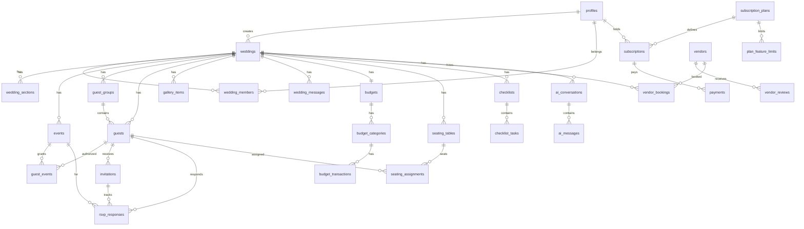

# VOWORA — Database Schema

> PostgreSQL 15+ on Supabase. Normalized, RLS-secured, scalable.
> This is the authoritative design reference; executable SQL lives in
> `supabase/migrations/` (ordered, versioned). Covers the **entire** platform.

---

## 1. Conventions

- **Primary keys:** `id uuid PRIMARY KEY DEFAULT gen_random_uuid()` (except config slugs).
- **Timestamps:** every table has `created_at timestamptz NOT NULL DEFAULT now()` and
  `updated_at timestamptz NOT NULL DEFAULT now()` (maintained by trigger).
- **Foreign keys:** explicit `REFERENCES ... ON DELETE` behavior per relationship; all FK
  columns indexed.
- **Money:** `numeric(12,2)` + ISO `currency` code (per wedding). No floats.
- **Soft delete:** `deleted_at timestamptz` on user-owned content needing recovery/audit
  (weddings, guests, media). Hard delete for transient/config rows.
- **Enums:** PostgreSQL `CREATE TYPE` for stable sets; `text + CHECK` for admin-configurable
  sets (event types, categories).
- **Names:** snake_case; junction tables named `a_b` (e.g. `guest_events`).
- **Multi-tenancy:** almost every domain table carries `wedding_id` → the RLS anchor.
- **Search path safety:** all `SECURITY DEFINER` functions `SET search_path = public`.

---

## 2. Enum Types

```sql
CREATE TYPE platform_role      AS ENUM ('customer','vendor','support','admin','super_admin');
CREATE TYPE wedding_role       AS ENUM ('owner','partner','planner','family','viewer');
CREATE TYPE wedding_status     AS ENUM ('draft','published','unpublished','archived');
CREATE TYPE section_type       AS ENUM (
  'hero','couple_intro','family_intro','story','events','countdown','venue',
  'photo_gallery','video_gallery','dress_code','invitation_message','rsvp',
  'gift_registry','wishes','contact');
CREATE TYPE invitation_status  AS ENUM ('active','revoked','expired');
CREATE TYPE rsvp_status        AS ENUM ('accepted','declined','maybe','pending');
CREATE TYPE guest_category     AS ENUM ('family','friend','colleague','vip','relative','other');
CREATE TYPE subscription_status AS ENUM ('trialing','active','past_due','canceled','expired');
CREATE TYPE payment_status     AS ENUM ('pending','succeeded','failed','refunded');
CREATE TYPE order_status       AS ENUM ('requested','in_review','in_progress','delivered','canceled');
CREATE TYPE vendor_status      AS ENUM ('pending','approved','rejected','suspended');
CREATE TYPE enquiry_status     AS ENUM ('new','contacted','quoted','booked','closed');
CREATE TYPE booking_status     AS ENUM ('enquiry','tentative','confirmed','completed','canceled');
CREATE TYPE media_kind         AS ENUM ('image','video','audio','document');
CREATE TYPE moderation_status  AS ENUM ('pending','approved','rejected');
CREATE TYPE visibility         AS ENUM ('public','private','invitation_only');
CREATE TYPE task_status        AS ENUM ('todo','in_progress','done','blocked');
CREATE TYPE gift_status        AS ENUM ('available','reserved','purchased');
CREATE TYPE notification_kind  AS ENUM ('rsvp','invitation','system','billing','task','announcement');
```

---

## 3. Helper Functions & Triggers

### Authorization helpers (STABLE; used inside RLS)
```sql
-- Platform admin check
CREATE FUNCTION public.is_platform_admin() RETURNS boolean
LANGUAGE sql STABLE SECURITY DEFINER SET search_path = public AS $$
  SELECT EXISTS (
    SELECT 1 FROM profiles
    WHERE id = auth.uid() AND platform_role IN ('admin','super_admin')
  );
$$;

-- Membership check
CREATE FUNCTION public.is_wedding_member(w uuid) RETURNS boolean
LANGUAGE sql STABLE SECURITY DEFINER SET search_path = public AS $$
  SELECT EXISTS (
    SELECT 1 FROM wedding_members
    WHERE wedding_id = w AND user_id = auth.uid()
  );
$$;

-- Role check
CREATE FUNCTION public.has_wedding_role(w uuid, roles text[]) RETURNS boolean
LANGUAGE sql STABLE SECURITY DEFINER SET search_path = public AS $$
  SELECT EXISTS (
    SELECT 1 FROM wedding_members
    WHERE wedding_id = w AND user_id = auth.uid() AND role::text = ANY(roles)
  );
$$;

-- Fine-grained permission (role defaults + per-member overrides)
CREATE FUNCTION public.wedding_permission(w uuid, perm text) RETURNS boolean
LANGUAGE sql STABLE SECURITY DEFINER SET search_path = public AS $$
  SELECT EXISTS (
    SELECT 1 FROM wedding_members m
    WHERE m.wedding_id = w AND m.user_id = auth.uid()
      AND (
        m.role IN ('owner','partner')
        OR (m.role = 'planner' AND perm <> 'delete_wedding')
        OR (perm = ANY (m.permissions))
      )
  );
$$;
```

### Triggers
```sql
-- updated_at maintenance (applied to every table with updated_at)
CREATE FUNCTION public.set_updated_at() RETURNS trigger
LANGUAGE plpgsql AS $$
BEGIN NEW.updated_at = now(); RETURN NEW; END; $$;

-- Auto-create profile on signup
CREATE FUNCTION public.handle_new_user() RETURNS trigger
LANGUAGE plpgsql SECURITY DEFINER SET search_path = public AS $$
BEGIN
  INSERT INTO public.profiles (id, full_name, avatar_url, platform_role)
  VALUES (
    NEW.id,
    COALESCE(NEW.raw_user_meta_data->>'full_name',''),
    NEW.raw_user_meta_data->>'avatar_url',
    'customer'
  );
  RETURN NEW;
END; $$;
CREATE TRIGGER on_auth_user_created
  AFTER INSERT ON auth.users
  FOR EACH ROW EXECUTE FUNCTION public.handle_new_user();

-- Auto-add creator as wedding owner
CREATE FUNCTION public.handle_new_wedding() RETURNS trigger
LANGUAGE plpgsql SECURITY DEFINER SET search_path = public AS $$
BEGIN
  INSERT INTO public.wedding_members (wedding_id, user_id, role)
  VALUES (NEW.id, NEW.created_by, 'owner');
  RETURN NEW;
END; $$;
```

---

## 4. Identity & Platform

### 4.1 `profiles`
| Column | Type | Constraints |
|---|---|---|
| id | uuid | PK, **FK → auth.users(id) ON DELETE CASCADE** |
| full_name | text | not null default '' |
| avatar_url | text | |
| platform_role | platform_role | not null default 'customer' |
| phone | text | |
| locale | text | not null default 'en' |
| country | text | |
| deleted_at | timestamptz | soft delete |
| created_at / updated_at | timestamptz | |

Indexes: PK. RLS: owner read/update self; admin read all; insert via trigger only.

### 4.2 `platform_settings` (configurable branding)
| Column | Type | Notes |
|---|---|---|
| key | text | PK (e.g. `brand_name`, `brand_logo_url`, `primary_color`, `font_pair`, `support_email`) |
| value | jsonb | not null |
| updated_by | uuid | FK profiles |
| updated_at | timestamptz | |

RLS: public read non-secret keys; write platform admin only. **Branding read from here →
rename without code changes.**

### 4.3 `admin_activity_logs` (audit)
| Column | Type |
|---|---|
| id | uuid PK |
| actor_id | uuid FK profiles |
| action | text not null |
| entity_type | text |
| entity_id | uuid |
| metadata | jsonb default '{}' |
| ip_address | inet |
| created_at | timestamptz |

Index: `(actor_id, created_at)`, `(entity_type, entity_id)`. RLS: admin read; insert via
service role / privileged function only.

### 4.4 `notifications`
| Column | Type |
|---|---|
| id | uuid PK |
| user_id | uuid FK profiles (nullable for wedding-wide) |
| wedding_id | uuid FK weddings (nullable) |
| kind | notification_kind |
| title | text not null |
| body | text |
| data | jsonb default '{}' |
| read_at | timestamptz |
| created_at | timestamptz |

Index: `(user_id, read_at, created_at)`. RLS: user reads/updates own; insert server-side.

### 4.5 `support_requests`
| Column | Type |
|---|---|
| id | uuid PK |
| user_id | uuid FK profiles |
| wedding_id | uuid FK weddings null |
| subject | text not null |
| message | text not null |
| status | text default 'open' (open/in_progress/resolved) |
| assigned_to | uuid FK profiles null |
| created_at / updated_at | timestamptz |

RLS: user reads/creates own; support/admin manage.

---

## 5. Wedding Core

### 5.1 `weddings`
| Column | Type | Constraints |
|---|---|---|
| id | uuid | PK |
| created_by | uuid | FK profiles, not null |
| slug | text | **unique** (public URL) |
| title | text | not null |
| partner_one_name | text | not null |
| partner_two_name | text | not null |
| couple_initials | text | |
| wedding_date | date | |
| timezone | text | not null default 'UTC' |
| currency | text | not null default 'USD' |
| locale | text | not null default 'en' |
| status | wedding_status | not null default 'draft' |
| template_id | uuid | FK templates null |
| theme_id | uuid | FK wedding_themes null |
| design_config | jsonb | default '{}' (colors, fonts, wording, music, wax seal, animation, intro) |
| seo_config | jsonb | default '{}' (title, description, og_version) |
| invitation_config | jsonb | default '{}' (envelope/card colors, fonts, wax seal, border, animation, intro, music) — added `0011` |
| custom_domain | text | unique null |
| subscription_id | uuid | FK subscriptions null |
| published_at | timestamptz | |
| deleted_at | timestamptz | |
| created_at / updated_at | timestamptz | |

Indexes: `slug` unique, `custom_domain` unique, `(created_by)`, `(status)`.
Trigger: `handle_new_wedding` adds owner membership.
RLS: members read; `wedding_permission(w,'edit_website')` update; owner delete; admin all.
**Public access only via `get_published_wedding(slug)` RPC — no anon table policy.**

### 5.2 `wedding_members`
| Column | Type | Constraints |
|---|---|---|
| id | uuid | PK |
| wedding_id | uuid | FK weddings ON DELETE CASCADE |
| user_id | uuid | FK profiles ON DELETE CASCADE |
| role | wedding_role | not null default 'viewer' |
| permissions | text[] | default '{}' (fine-grained overrides) |
| invited_by | uuid | FK profiles null |
| created_at / updated_at | timestamptz | |
| | | **unique (wedding_id, user_id)** |

Index: `(user_id)`, `(wedding_id)`. RLS: members read; owner/partner manage members.

### 5.3 `templates` (config)
| Column | Type |
|---|---|
| id | uuid PK |
| key | text unique not null (e.g. `luxury-gold`) |
| name | text not null |
| description | text |
| category | text (luxury/modern/traditional/minimal) |
| preview_image_url | text |
| default_config | jsonb default '{}' |
| min_plan_tier | text default 'free' |
| is_active | boolean default true |
| sort_order | int default 0 |
| created_at / updated_at | timestamptz |

RLS: public read active; admin write.

### 5.4 `wedding_themes` (config — 10 invitation themes)
| Column | Type |
|---|---|
| id | uuid PK |
| key | text unique not null |
| name | text not null |
| palette | jsonb not null (colors/gradients) |
| typography | jsonb not null (font pairs) |
| envelope_config | jsonb not null |
| card_config | jsonb not null |
| decor_elements | jsonb default '[]' |
| animation_variant | text not null |
| background_url | text |
| wax_seal_styles | jsonb default '[]' |
| min_plan_tier | text default 'free' |
| is_active | boolean default true |
| created_at / updated_at | timestamptz |

RLS: public read active; admin write.

### 5.5 `wedding_sections`
| Column | Type | Constraints |
|---|---|---|
| id | uuid | PK |
| wedding_id | uuid | FK weddings ON DELETE CASCADE |
| type | section_type | not null |
| title | text | |
| content | jsonb | default '{}' (section-specific data) |
| is_enabled | boolean | default true |
| sort_order | int | not null default 0 |
| created_at / updated_at | timestamptz | |

Index: `(wedding_id, sort_order)`. RLS: member read; `edit_website` write.

### 5.6 `events`
| Column | Type | Constraints |
|---|---|---|
| id | uuid | PK |
| wedding_id | uuid | FK weddings ON DELETE CASCADE |
| name | text | not null |
| event_type | text | not null (configurable: mehndi/nikah/baraat/walima/custom…) |
| description | text | |
| event_date | date | not null |
| start_time | time | |
| end_time | time | |
| timezone | text | not null |
| venue_name | text | |
| venue_id | uuid | FK venues null (discovery link) |
| address | text | |
| maps_url | text | |
| lat | double precision | |
| lng | double precision | |
| cover_image_url | text | |
| dress_code | text | |
| instructions | text | |
| artwork_config | jsonb | default '{}' |
| sort_order | int | default 0 |
| created_at / updated_at | timestamptz | |

Index: `(wedding_id, event_date)`. RLS: member read; `manage_events` write.
**Guest-facing event visibility filtered by `guest_events` in the invitation RPC.**

### 5.7 `media_assets`
| Column | Type |
|---|---|
| id | uuid PK |
| wedding_id | uuid FK weddings null ON DELETE CASCADE |
| uploaded_by | uuid FK profiles null |
| bucket | text not null |
| path | text not null |
| kind | media_kind not null |
| mime_type | text not null |
| size_bytes | bigint not null |
| width / height | int null |
| alt_text | text |
| moderation_status | moderation_status default 'approved' |
| visibility | visibility default 'private' |
| created_at / updated_at | timestamptz |
| | **unique (bucket, path)** |

Index: `(wedding_id)`, `(moderation_status)`. RLS: member read/write own wedding; guest
uploads inserted via RPC with `moderation_status='pending'`.

---

## 6. Guests, Invitations & RSVP

### 6.1 `guest_groups`
| Column | Type |
|---|---|
| id | uuid PK |
| wedding_id | uuid FK weddings ON DELETE CASCADE |
| name | text not null (family/group name) |
| notes | text |
| max_attendees | int default 1 |
| created_at / updated_at | timestamptz |

Index: `(wedding_id)`. RLS: member read; `manage_guests` write.

### 6.2 `guests`
| Column | Type | Constraints |
|---|---|---|
| id | uuid | PK |
| wedding_id | uuid | FK weddings ON DELETE CASCADE |
| group_id | uuid | FK guest_groups ON DELETE SET NULL null |
| name | text | not null |
| email | text | |
| phone | text | |
| category | guest_category | default 'other' |
| max_attendees | int | not null default 1, **CHECK > 0** |
| notes | text | |
| dietary_preferences | text | |
| is_vip | boolean | default false |
| deleted_at | timestamptz | |
| created_at / updated_at | timestamptz | |

Index: `(wedding_id)`, `(group_id)`, `(wedding_id, name)`.
RLS: member read; `manage_guests` write. **Never exposed via anon/public APIs.**

### 6.3 `guest_events` (authorization junction)
| Column | Type | Constraints |
|---|---|---|
| id | uuid | PK |
| guest_id | uuid | FK guests ON DELETE CASCADE |
| event_id | uuid | FK events ON DELETE CASCADE |
| wedding_id | uuid | FK weddings ON DELETE CASCADE (denormalized for RLS) |
| allowed_attendees | int | null (override; else guest.max_attendees) |
| created_at | timestamptz | |
| | | **unique (guest_id, event_id)** |

Index: `(event_id)`, `(guest_id)`, `(wedding_id)`.
RLS: member read; `manage_guests` write. **Defines exactly which events a guest may see/RSVP.**

### 6.4 `invitations` (secure capability tokens)
| Column | Type | Constraints |
|---|---|---|
| id | uuid | PK |
| wedding_id | uuid | FK weddings ON DELETE CASCADE |
| guest_id | uuid | FK guests ON DELETE CASCADE |
| token | text | **unique not null** (CSPRNG ≥128-bit, base64url) |
| status | invitation_status | not null default 'active' |
| expires_at | timestamptz | null |
| max_uses | int | null |
| use_count | int | not null default 0 |
| delivered_via | text | (whatsapp/email/copy/qr) |
| delivered_at | timestamptz | null |
| last_opened_at | timestamptz | null |
| revoked_at | timestamptz | null |
| created_at / updated_at | timestamptz | |

Index: `token` **unique**, `(guest_id)`, `(wedding_id, status)`.
RLS: member read/manage; **anon never reads table** — only `get_invitation(token)` RPC.
Token generated server-side; revocation flips `status`; generic 404 on invalid.

### 6.5 `rsvp_responses`
| Column | Type | Constraints |
|---|---|---|
| id | uuid | PK |
| wedding_id | uuid | FK weddings ON DELETE CASCADE |
| guest_id | uuid | FK guests ON DELETE CASCADE |
| event_id | uuid | FK events ON DELETE CASCADE |
| invitation_id | uuid | FK invitations ON DELETE SET NULL null |
| status | rsvp_status | not null default 'pending' |
| attendee_count | int | not null default 0, **CHECK ≥ 0** |
| message | text | |
| dietary_preferences | text | |
| responded_at | timestamptz | |
| created_at / updated_at | timestamptz | |
| | | **unique (guest_id, event_id)** |

Index: `(wedding_id, event_id)`, `(guest_id)`, `(status)`.
RLS: member read; **guest writes only via `submit_rsvp(token,…)` RPC** which enforces
event ∈ guest_events and `attendee_count ≤ allowed`. Response history kept via audit/
`updated_at` + optional `rsvp_history` (Phase 5).

---

## 7. Gallery & Messages

### 7.1 `gallery_items`
| Column | Type |
|---|---|
| id | uuid PK |
| wedding_id | uuid FK weddings ON DELETE CASCADE |
| media_asset_id | uuid FK media_assets null |
| kind | media_kind not null |
| url | text not null |
| thumbnail_url | text |
| caption | text |
| uploaded_by_guest_id | uuid FK guests null (guest upload) |
| moderation_status | moderation_status default 'pending' for guest uploads |
| visibility | visibility default 'invitation_only' |
| allow_download | boolean default false |
| sort_order | int default 0 |
| approved_by | uuid FK profiles null |
| created_at / updated_at | timestamptz |

Index: `(wedding_id, moderation_status)`. RLS: member manage; public read only approved +
public via RPC; guest upload via RPC.

### 7.2 `wedding_messages` (guest wishes)
| Column | Type |
|---|---|
| id | uuid PK |
| wedding_id | uuid FK weddings ON DELETE CASCADE |
| guest_id | uuid FK guests null |
| author_name | text not null |
| message | text not null |
| visibility | visibility default 'public' |
| moderation_status | moderation_status default 'pending' |
| approved_by | uuid FK profiles null |
| created_at | timestamptz |

Index: `(wedding_id, moderation_status)`. RLS: member moderate; guest submit via RPC;
public read approved+public via RPC.

---

## 8. Subscriptions & Monetization

### 8.1 `subscription_plans` (config)
| Column | Type |
|---|---|
| id | uuid PK |
| key | text unique not null (free/starter/premium/luxury/custom) |
| name | text not null |
| description | text |
| tier | int not null (ordering) |
| price_monthly | numeric(12,2) |
| price_yearly | numeric(12,2) |
| currency | text default 'USD' |
| is_active | boolean default true |
| is_custom | boolean default false |
| sort_order | int default 0 |
| created_at / updated_at | timestamptz |

RLS: public read active; admin write. **Pricing admin-configurable.**

### 8.2 `plan_feature_limits` (config)
| Column | Type |
|---|---|
| id | uuid PK |
| plan_id | uuid FK subscription_plans ON DELETE CASCADE |
| feature_key | text not null (max_guests/max_events/max_weddings/premium_themes/budget_planner/ai_assistant/custom_domain/advanced_animations…) |
| limit_value | text not null (numeric string or 'true'/'false'/'unlimited') |
| | **unique (plan_id, feature_key)** |

RLS: public read; admin write. **Enforced server-side.**

### 8.3 `subscriptions`
| Column | Type | Constraints |
|---|---|---|
| id | uuid | PK |
| user_id | uuid | FK profiles |
| plan_id | uuid | FK subscription_plans |
| status | subscription_status | not null default 'active' |
| provider | text | (stripe/manual/…) |
| provider_subscription_id | text | unique null |
| current_period_start | timestamptz | |
| current_period_end | timestamptz | |
| cancel_at_period_end | boolean | default false |
| canceled_at | timestamptz | |
| created_at / updated_at | timestamptz | |

Index: `(user_id)`, `(provider_subscription_id)`. RLS: user read own; admin manage;
**writes only via verified webhook/server logic.**

### 8.4 `payments`
| Column | Type |
|---|---|
| id | uuid PK |
| user_id | uuid FK profiles |
| subscription_id | uuid FK subscriptions null |
| amount | numeric(12,2) not null |
| currency | text not null |
| status | payment_status not null default 'pending' |
| provider | text not null |
| provider_payment_id | text unique null |
| idempotency_key | text unique null |
| metadata | jsonb default '{}' |
| created_at / updated_at | timestamptz |

Index: `(user_id)`, `(provider_payment_id)`. RLS: user read own; admin read; writes server-side.

### 8.5 `invoices`
| Column | Type |
|---|---|
| id | uuid PK |
| user_id | uuid FK profiles |
| payment_id | uuid FK payments null |
| number | text unique not null |
| amount | numeric(12,2) not null |
| currency | text not null |
| status | text default 'paid' |
| pdf_url | text |
| issued_at | timestamptz default now() |
| created_at | timestamptz |

RLS: user read own; admin read; generated server-side.

### 8.6 `custom_orders` (Custom Design Service)
| Column | Type |
|---|---|
| id | uuid PK |
| user_id | uuid FK profiles |
| wedding_id | uuid FK weddings null |
| brief | text not null |
| requirements | jsonb default '{}' |
| budget | numeric(12,2) |
| currency | text |
| status | order_status default 'requested' |
| assigned_to | uuid FK profiles null (designer) |
| quote_amount | numeric(12,2) |
| delivered_url | text |
| created_at / updated_at | timestamptz |

RLS: user read/create own; admin/designer manage.

---

## 9. Budget Planner

### 9.1 `budgets`
| Column | Type |
|---|---|
| id | uuid PK |
| wedding_id | uuid FK weddings ON DELETE CASCADE unique |
| total_amount | numeric(12,2) not null default 0 |
| currency | text not null |
| alert_threshold_pct | int default 90 |
| created_at / updated_at | timestamptz |

RLS: member read; `manage_budget` write.

### 9.2 `budget_categories`
| Column | Type |
|---|---|
| id | uuid PK |
| wedding_id | uuid FK weddings ON DELETE CASCADE |
| event_id | uuid FK events null (event-wise budget) |
| name | text not null (venue/catering/photography/…) |
| allocated_amount | numeric(12,2) default 0 |
| sort_order | int default 0 |
| created_at / updated_at | timestamptz |

Index: `(wedding_id)`. RLS: member read; `manage_budget` write.

### 9.3 `budget_transactions`
| Column | Type |
|---|---|
| id | uuid PK |
| wedding_id | uuid FK weddings ON DELETE CASCADE |
| category_id | uuid FK budget_categories ON DELETE CASCADE |
| vendor_booking_id | uuid FK vendor_bookings null |
| description | text not null |
| amount | numeric(12,2) not null |
| paid_amount | numeric(12,2) default 0 |
| status | text default 'pending' (pending/partial/paid) |
| due_date | date |
| paid_at | timestamptz |
| receipt_url | text |
| created_at / updated_at | timestamptz |

Index: `(category_id)`, `(wedding_id, status)`. RLS: member read; `manage_budget` write.

---

## 10. Vendors & Venues

### 10.1 `vendor_categories` (config)
`id uuid PK, key text unique, name text, sort_order int, is_active boolean, timestamps`.
RLS: public read; admin write.

### 10.2 `vendors`
| Column | Type |
|---|---|
| id | uuid PK |
| owner_id | uuid FK profiles (vendor account) |
| category_id | uuid FK vendor_categories |
| business_name | text not null |
| slug | text unique not null |
| description | text |
| logo_url | text |
| cover_url | text |
| city | text |
| country | text |
| service_locations | text[] default '{}' |
| price_range_min / price_range_max | numeric(12,2) |
| currency | text |
| contact_email / contact_phone | text |
| website | text |
| status | vendor_status default 'pending' |
| rating_avg | numeric(3,2) default 0 (computed from real reviews) |
| rating_count | int default 0 |
| verified_at | timestamptz |
| created_at / updated_at | timestamptz |

Index: `(category_id, status)`, `(city)`, `slug`. RLS: public read approved; owner manage
own; admin approve/manage. **No fake profiles/reviews.**

### 10.3 `vendor_packages`
`id, vendor_id FK, name, description, price numeric, currency, inclusions jsonb, is_active,
timestamps`. RLS: public read approved vendor; owner write.

### 10.4 `vendor_portfolio_items`
`id, vendor_id FK, media_asset_id FK null, kind media_kind, url, caption, sort_order,
timestamps`. RLS: public read approved; owner write.

### 10.5 `vendor_reviews`
| Column | Type |
|---|---|
| id | uuid PK |
| vendor_id | uuid FK vendors ON DELETE CASCADE |
| user_id | uuid FK profiles |
| wedding_id | uuid FK weddings null |
| rating | int not null **CHECK 1–5** |
| comment | text |
| is_verified | boolean default false (verified booking) |
| created_at | timestamptz |
| | **unique (vendor_id, user_id, wedding_id)** |

RLS: public read; author create/update own (only with real booking); admin moderate.

### 10.6 `vendor_enquiries`
`id, vendor_id FK, user_id FK, wedding_id FK null, event_id FK null, message, status
enquiry_status, quoted_amount numeric, quote_notes, created_at/updated_at`.
RLS: sender + vendor owner read; involved parties write; admin all.

### 10.7 `vendor_bookings`
| Column | Type |
|---|---|
| id | uuid PK |
| vendor_id | uuid FK vendors |
| wedding_id | uuid FK weddings |
| enquiry_id | uuid FK vendor_enquiries null |
| package_id | uuid FK vendor_packages null |
| status | booking_status default 'enquiry' |
| agreed_amount | numeric(12,2) |
| currency | text |
| event_date | date |
| arrival_status | text default 'expected' (command center) |
| arrived_at | timestamptz |
| notes | text |
| created_at / updated_at | timestamptz |

Index: `(wedding_id)`, `(vendor_id)`. RLS: wedding member + vendor owner read; relevant
party update; admin all.

### 10.8 `venues` (discovery)
| Column | Type |
|---|---|
| id | uuid PK |
| name | text not null |
| slug | text unique |
| venue_type | text (banquet/hall/outdoor/farmhouse/hotel…) |
| city | text not null |
| country | text |
| address | text |
| lat / lng | double precision |
| capacity_min / capacity_max | int |
| indoor / outdoor | boolean |
| parking | boolean |
| catering_provided | boolean |
| facilities | text[] default '{}' |
| price_range_min / max | numeric(12,2) |
| currency | text |
| price_is_estimate | boolean default true |
| photos | jsonb default '[]' |
| contact_email / phone | text |
| is_verified | boolean default false |
| status | vendor_status default 'pending' |
| created_at / updated_at | timestamptz |

Index: `(city, venue_type)`, `(status)`. RLS: public read approved; admin manage.
**Estimated vs verified clearly flagged.**

### 10.9 `venue_enquiries`
`id, venue_id FK, user_id FK, wedding_id FK null, event_date date, guest_count int, message,
status enquiry_status, created_at/updated_at`. RLS: sender read/create; admin manage.

---

## 11. Planning Modules

### 11.1 `checklists`
`id, wedding_id FK, name text, description, created_at/updated_at`. RLS member.

### 11.2 `checklist_tasks`
| Column | Type |
|---|---|
| id | uuid PK |
| checklist_id | uuid FK checklists ON DELETE CASCADE |
| wedding_id | uuid FK weddings ON DELETE CASCADE |
| title | text not null |
| description | text |
| category | text (pre_wedding/event_prep/vendor/clothing/invitations/venue/wedding_day/custom) |
| status | task_status default 'todo' |
| due_date | date |
| reminder_at | timestamptz |
| assigned_to | uuid FK profiles null |
| sort_order | int default 0 |
| completed_at | timestamptz |
| created_at / updated_at | timestamptz |

Index: `(wedding_id, status)`, `(checklist_id)`. RLS: member read; `manage_tasks` write.

### 11.3 `seating_tables`
`id, wedding_id FK, event_id FK null, name text, capacity int not null CHECK>0, shape text
(round/rect), position_x numeric, position_y numeric, is_vip boolean default false,
created_at/updated_at`. Index `(wedding_id)`. RLS member.

### 11.4 `seating_assignments`
`id, table_id FK seating_tables ON DELETE CASCADE, guest_id FK guests ON DELETE CASCADE,
wedding_id FK, seat_number int, created_at, unique(table_id, guest_id)`.
RLS member; capacity enforced server-side.

### 11.5 `moodboards`
`id, wedding_id FK, name text, description, created_at/updated_at`. RLS member.

### 11.6 `moodboard_items`
`id, moodboard_id FK ON DELETE CASCADE, wedding_id FK, media_asset_id FK null, url text,
note text, position_x numeric, position_y numeric, sort_order int, created_at`. RLS member.

### 11.7 `gift_registries`
`id, wedding_id FK unique, title text, description, visibility visibility default 'public',
allow_external_links boolean default true, created_at/updated_at`. RLS member manage;
public read via RPC if public. **Never force purchase.**

### 11.8 `gift_items`
`id, registry_id FK gift_registries ON DELETE CASCADE, wedding_id FK, name text, description,
image_url, external_url, price numeric, currency, status gift_status default 'available',
reserved_by_guest_id uuid FK guests null, sort_order int, created_at/updated_at`.
RLS member manage; guest reserve via RPC.

### 11.9 `hotels` (destination)
`id, wedding_id FK, name text, address, city, contact_phone, contact_email, website,
maps_url, notes, created_at/updated_at`. RLS member.

### 11.10 `guest_rooms`
`id, wedding_id FK, hotel_id FK hotels null, guest_id FK guests null, group_id FK
guest_groups null, room_type text, room_number text, check_in date, check_out date,
occupants int, notes, created_at/updated_at`. Index `(wedding_id)`. RLS member.

### 11.11 `travel_itineraries`
`id, wedding_id FK, guest_id FK guests null, group_id FK guest_groups null, type text
(flight/transport/pickup/itinerary), title text, details jsonb, scheduled_at timestamptz,
pickup_location text, contact text, instructions text, created_at/updated_at`.
Index `(wedding_id)`. RLS member; guest read own via RPC.

### 11.12 `day_of_tasks` (command center)
| Column | Type |
|---|---|
| id | uuid PK |
| wedding_id | uuid FK weddings ON DELETE CASCADE |
| event_id | uuid FK events null |
| title | text not null |
| category | text (vendor_arrival/decoration/catering/schedule/announcement/emergency) |
| status | task_status default 'todo' |
| assigned_to | uuid FK profiles null |
| responsible_name | text |
| scheduled_at | timestamptz |
| completed_at | timestamptz |
| is_emergency | boolean default false |
| contact_phone | text |
| notes | text |
| created_at / updated_at | timestamptz |

Index `(wedding_id, scheduled_at)`. RLS: member with `view_command_center`; Realtime enabled.

### 11.13 `announcements` (command center)
`id, wedding_id FK, event_id FK null, title text, body text, priority text default 'normal',
is_delay boolean default false, created_by uuid FK profiles, created_at`. RLS scoped member;
Realtime enabled.

---

## 12. AI Assistant

### 12.1 `ai_conversations`
`id, wedding_id FK, user_id FK profiles, title text, created_at/updated_at`.
RLS: owner read/write own; **never cross-user**.

### 12.2 `ai_messages`
`id, conversation_id FK ON DELETE CASCADE, role text (user/assistant/system), content text,
tokens int, created_at`. Index `(conversation_id, created_at)`. RLS via conversation owner.
**Guest PII redacted before provider call; keys server-side only.**

---

## 13. Entity Relationships (overview)



---

## 14. Row Level Security — Policy Matrix

**RLS enabled on every table.** Default deny. Helper functions from §3.

| Table | SELECT | INSERT | UPDATE | DELETE |
|---|---|---|---|---|
| profiles | self OR admin | trigger only | self (not role) OR admin | admin (soft) |
| platform_settings | public (non-secret) | admin | admin | admin |
| admin_activity_logs | admin | service/privileged fn | — | — |
| notifications | own | server | own (read_at) | own |
| support_requests | own OR support/admin | own | support/admin | admin |
| weddings | member OR admin | authenticated (own) | `edit_website` perm | owner OR admin |
| wedding_members | member | owner/partner OR admin | owner/partner OR admin | owner/partner OR admin |
| templates | public active | admin | admin | admin |
| wedding_themes | public active | admin | admin | admin |
| wedding_sections | member | `edit_website` | `edit_website` | `edit_website` |
| events | member | `manage_events` | `manage_events` | `manage_events` |
| media_assets | member | member (validated) | member | member |
| guest_groups | member | `manage_guests` | `manage_guests` | `manage_guests` |
| guests | member | `manage_guests` | `manage_guests` | `manage_guests` (soft) |
| guest_events | member | `manage_guests` | `manage_guests` | `manage_guests` |
| invitations | member | `manage_guests` | `manage_guests` | `manage_guests` |
| rsvp_responses | member | **RPC only** | **RPC only** | member |
| gallery_items | member; public approved via RPC | member/RPC | member | member |
| wedding_messages | member; public approved via RPC | RPC | member (moderate) | member |
| subscription_plans | public active | admin | admin | admin |
| plan_feature_limits | public | admin | admin | admin |
| subscriptions | own OR admin | server/webhook | server/webhook | admin |
| payments | own OR admin | server | server | — |
| invoices | own OR admin | server | server | — |
| custom_orders | own OR admin | own | admin/designer | admin |
| budgets | member | `manage_budget` | `manage_budget` | `manage_budget` |
| budget_categories | member | `manage_budget` | `manage_budget` | `manage_budget` |
| budget_transactions | member | `manage_budget` | `manage_budget` | `manage_budget` |
| vendor_categories | public | admin | admin | admin |
| vendors | public approved; owner | owner (pending) | owner OR admin | admin |
| vendor_packages | public approved; owner | owner | owner | owner |
| vendor_portfolio_items | public approved; owner | owner | owner | owner |
| vendor_reviews | public | author (real booking) | author OR admin | admin |
| vendor_enquiries | sender + vendor owner | sender | involved | admin |
| vendor_bookings | wedding member + vendor owner | involved | involved | admin |
| venues | public approved | admin | admin | admin |
| venue_enquiries | sender OR admin | sender | admin | admin |
| checklists | member | member | member | member |
| checklist_tasks | member | `manage_tasks` | `manage_tasks` | `manage_tasks` |
| seating_tables | member | member | member | member |
| seating_assignments | member | member | member | member |
| moodboards | member | member | member | member |
| moodboard_items | member | member | member | member |
| gift_registries | member; public via RPC | member | member | member |
| gift_items | member; public via RPC | member | member/RPC reserve | member |
| hotels | member | member | member | member |
| guest_rooms | member | member | member | member |
| travel_itineraries | member; guest own via RPC | member | member | member |
| day_of_tasks | `view_command_center` | permitted member | permitted member | permitted member |
| announcements | scoped member | permitted member | permitted member | permitted member |
| ai_conversations | owner | owner | owner | owner |
| ai_messages | conversation owner | owner/server | — | owner |

### Example policies (representative DDL)
```sql
ALTER TABLE public.weddings ENABLE ROW LEVEL SECURITY;

CREATE POLICY weddings_select ON public.weddings FOR SELECT
  USING (public.is_wedding_member(id) OR public.is_platform_admin());

CREATE POLICY weddings_insert ON public.weddings FOR INSERT
  WITH CHECK (created_by = auth.uid());

CREATE POLICY weddings_update ON public.weddings FOR UPDATE
  USING (public.wedding_permission(id, 'edit_website') OR public.is_platform_admin());

CREATE POLICY weddings_delete ON public.weddings FOR DELETE
  USING (public.has_wedding_role(id, ARRAY['owner']) OR public.is_platform_admin());

ALTER TABLE public.guests ENABLE ROW LEVEL SECURITY;
CREATE POLICY guests_select ON public.guests FOR SELECT
  USING (public.is_wedding_member(wedding_id) OR public.is_platform_admin());
CREATE POLICY guests_write ON public.guests FOR ALL
  USING (public.wedding_permission(wedding_id, 'manage_guests'))
  WITH CHECK (public.wedding_permission(wedding_id, 'manage_guests'));
-- No anon policy: guests never read this table directly.
```

---

## 15. Public & Guest RPCs (SECURITY DEFINER)

All `SET search_path = public`, owned by privileged role, granted to `anon`/`authenticated`
as appropriate. Return minimal authorized fields. Rate-limited at the API layer.

```sql
-- Public published wedding (no guest/private data)
CREATE FUNCTION public.get_published_wedding(p_slug text)
RETURNS jsonb LANGUAGE plpgsql SECURITY DEFINER SET search_path = public AS $$
DECLARE w public.weddings; result jsonb;
BEGIN
  SELECT * INTO w FROM weddings WHERE slug = p_slug AND status = 'published' AND deleted_at IS NULL;
  IF NOT FOUND THEN RETURN NULL; END IF;
  SELECT jsonb_build_object(
    'id', w.id, 'title', w.title, 'partner_one_name', w.partner_one_name,
    'partner_two_name', w.partner_two_name, 'wedding_date', w.wedding_date,
    'timezone', w.timezone, 'design_config', w.design_config, 'seo_config', w.seo_config,
    'theme', (SELECT to_jsonb(t) FROM wedding_themes t WHERE t.id = w.theme_id),
    'sections', (SELECT jsonb_agg(to_jsonb(s) ORDER BY sort_order)
                 FROM wedding_sections s WHERE s.wedding_id = w.id AND is_enabled),
    'events', (SELECT jsonb_agg(to_jsonb(e) ORDER BY event_date)
               FROM events e WHERE e.wedding_id = w.id)
  ) INTO result;
  RETURN result;
END; $$;

-- Personalized invitation: token → guest + ONLY authorized events
CREATE FUNCTION public.get_invitation(p_token text)
RETURNS jsonb LANGUAGE plpgsql SECURITY DEFINER SET search_path = public AS $$
DECLARE inv public.invitations; g public.guest; result jsonb;
BEGIN
  SELECT * INTO inv FROM invitations
   WHERE token = p_token AND status = 'active'
     AND (expires_at IS NULL OR expires_at > now())
     AND (max_uses IS NULL OR use_count < max_uses);
  IF NOT FOUND THEN RETURN NULL; END IF;          -- generic failure, no enumeration
  SELECT * INTO g FROM guests WHERE id = inv.guest_id AND deleted_at IS NULL;
  IF NOT FOUND THEN RETURN NULL; END IF;
  UPDATE invitations SET use_count = use_count + 1, last_opened_at = now() WHERE id = inv.id;
  SELECT jsonb_build_object(
    'guest_name', g.name, 'max_attendees', g.max_attendees,
    'wedding', public.get_published_wedding((SELECT slug FROM weddings WHERE id = inv.wedding_id)),
    'allowed_events', (SELECT jsonb_agg(to_jsonb(e) ORDER BY e.event_date)
        FROM events e JOIN guest_events ge ON ge.event_id = e.id
        WHERE ge.guest_id = g.id),
    'rsvp', (SELECT jsonb_agg(to_jsonb(r)) FROM rsvp_responses r WHERE r.guest_id = g.id)
  ) INTO result;
  RETURN result;
END; $$;

-- Guest RSVP: enforces authorization + attendee limit
CREATE FUNCTION public.submit_rsvp(p_token text, p_responses jsonb)
RETURNS jsonb LANGUAGE plpgsql SECURITY DEFINER SET search_path = public AS $$
DECLARE inv public.invitations; r jsonb; eid uuid; allowed int; cnt int;
BEGIN
  SELECT * INTO inv FROM invitations
   WHERE token = p_token AND status = 'active'
     AND (expires_at IS NULL OR expires_at > now());
  IF NOT FOUND THEN RAISE EXCEPTION 'invalid_invitation'; END IF;
  FOR r IN SELECT * FROM jsonb_array_elements(p_responses) LOOP
    eid := (r->>'event_id')::uuid;
    -- must be an authorized event for this guest
    IF NOT EXISTS (SELECT 1 FROM guest_events WHERE guest_id = inv.guest_id AND event_id = eid) THEN
      RAISE EXCEPTION 'unauthorized_event';
    END IF;
    SELECT COALESCE(ge.allowed_attendees, g.max_attendees) INTO allowed
      FROM guests g LEFT JOIN guest_events ge ON ge.guest_id = g.id AND ge.event_id = eid
      WHERE g.id = inv.guest_id;
    cnt := COALESCE((r->>'attendee_count')::int, 0);
    IF cnt < 0 OR cnt > allowed THEN RAISE EXCEPTION 'attendee_limit_exceeded'; END IF;
    INSERT INTO rsvp_responses (wedding_id, guest_id, event_id, invitation_id, status, attendee_count, message, responded_at)
    VALUES (inv.wedding_id, inv.guest_id, eid, inv.id,
            (r->>'status')::rsvp_status, cnt, r->>'message', now())
    ON CONFLICT (guest_id, event_id)
    DO UPDATE SET status = EXCLUDED.status, attendee_count = EXCLUDED.attendee_count,
                  message = EXCLUDED.message, responded_at = now(), updated_at = now();
  END LOOP;
  RETURN jsonb_build_object('ok', true);
END; $$;

REVOKE ALL ON FUNCTION public.get_invitation(text) FROM public;
GRANT EXECUTE ON FUNCTION public.get_invitation(text) TO anon, authenticated;
-- (similar grants for get_published_wedding, submit_rsvp, submit_guest_wish, gallery upload)
```

---

## 16. Storage Buckets & Policies

| Bucket | Public | Policies |
|---|---|---|
| `public-assets` | yes | anon SELECT; admin INSERT/UPDATE/DELETE |
| `wedding-media` | no | member SELECT/INSERT/UPDATE/DELETE via `is_wedding_member`/permission on path prefix `{wedding_id}/...`; public published items served via signed URLs |
| `guest-uploads` | no | INSERT only via signed URL issued by RPC (`moderation_status='pending'`); member SELECT/approve |
| `avatars` | no | owner SELECT/INSERT/UPDATE on `{user_id}/...` |
| `documents` | no | owner/admin SELECT; server INSERT |

Storage path convention: `{wedding_id}/{asset_id}.{ext}` enables path-prefix RLS.
File type/size validated server-side **before** issuing signed upload URLs.

---

## 17. Indexing Summary

- All FK columns indexed.
- Unique: `weddings.slug`, `weddings.custom_domain`, `invitations.token`,
  `vendors.slug`, `venues.slug`, `templates.key`, `wedding_themes.key`,
  `subscription_plans.key`, `payments.provider_payment_id`, `payments.idempotency_key`,
  junction uniques (`guest_events`, `seating_assignments`, `rsvp_responses`,
  `wedding_members`, `plan_feature_limits`, `vendor_reviews`).
- Query indexes: `events(wedding_id,event_date)`, `guests(wedding_id,name)`,
  `rsvp_responses(wedding_id,event_id)`, `invitations(wedding_id,status)`,
  `gallery_items(wedding_id,moderation_status)`, `checklist_tasks(wedding_id,status)`,
  `day_of_tasks(wedding_id,scheduled_at)`, `vendors(category_id,status)`,
  `venues(city,venue_type)`, `notifications(user_id,read_at,created_at)`.
- Partial index: `invitations(token) WHERE status='active'` for hot lookup.

---

## 18. Migration Strategy

- Ordered, versioned files in `supabase/migrations/`. **Phases 1–4 (schema) shipped:**
  - `0001_extensions.sql` — pgcrypto (Supabase guarantee).
  - `0002_enums.sql` — foundation enums (platform/wedding roles, status, section, subscription,
    media, moderation, visibility, notification, payment, order).
  - `0003_identity.sql` — `profiles`, `platform_settings`, `admin_activity_logs`.
  - `0004_wedding_core.sql` — `templates`, `wedding_themes`, `weddings`, `wedding_members`,
    `wedding_sections`, `media_assets`, `notifications`, `support_requests`.
  - `0005_billing_config.sql` — `subscription_plans`, `plan_feature_limits`, `subscriptions`,
    `payments`, `invoices`, `custom_orders` (+ `weddings.subscription_id` FK).
  - `0006_helpers_triggers.sql` — authorization helpers, `set_updated_at`, `handle_new_user`,
    `handle_new_wedding`, updated_at triggers.
  - `0007_rls.sql` — RLS + policies for all Phase 1 tables; `guard_profile_role` escalation guard.
  - `0008_storage.sql` — buckets + object policies.
  - `0009_seed_config.sql` — branding defaults, 10 themes, 4 templates, 5 plans + feature limits.
  - `0010_public_rpc.sql` — `get_published_wedding(p_slug)` `SECURITY DEFINER` RPC returning
    published wedding public fields + theme + enabled ordered sections (NULL for draft/missing).
  - `0011_invitation.sql` — adds `weddings.invitation_config jsonb` (per-wedding envelope/card
    overrides) and extends `get_published_wedding` to expose `invitation_config` + `published_at`.
  - `0012_events_guests.sql` — `events`, `guest_groups`, `guests`, `guest_events` (authorization
    junction), `invitations` (capability tokens) + `guest_category`/`invitation_status` enums;
    `feature_limit` resolver, server-side guest/event cap triggers, cross-wedding `guest_event`
    validation trigger; default-deny RLS (member reads, permission-gated writes, no anon policy).
  - `0013_guest_access.sql` — `wedding_public_json` internal helper; `get_published_wedding` now
    includes public events; `get_invitation(p_token)` `SECURITY DEFINER` capability RPC revealing
    only the guest's name + authorized events (generic NULL on any failure, increments open count).
- **Later phases append migrations** (never destructive rewrites): remaining domain enums
  (`rsvp_status`, `vendor_status`, `task_status`, `gift_status`, …) and tables for RSVP,
  gallery/messages, budget, vendors/venues, planning modules, AI — followed by their RLS and the
  guest RPCs (`submit_rsvp`, …) and any storage changes.
- Each migration idempotent where possible (`IF NOT EXISTS`, `on conflict do nothing`,
  `drop policy if exists`), applied via `supabase db push` / CLI; versioned in git.
- `npm run db:check` validates every migration against embedded Postgres (PGlite) with stubbed
  Supabase primitives and runs RLS/trigger smoke tests — no live project required. Still run
  `supabase db push` against a real project before production.
- **Seed = configuration only** (10 themes, templates, 5 plans + feature limits, platform branding
  defaults). **No fake users, reviews, testimonials or stats.** Vendor categories seed with the
  vendor marketplace phase (its table does not exist in Phase 1).

---

## 19. Data Privacy & Deletion

- Guest PII (email/phone) only in `guests`, member-readable, never public.
- Account deletion: soft-delete `profiles` + cascade/anonymize owned weddings per policy;
  remove storage; revoke invitations; delete AI conversations. Finalized Phase 8.
- Wedding deletion: cascade domain rows; revoke all invitations; purge media.
- Data minimization: store only what features require; AI prompts redact guest PII.