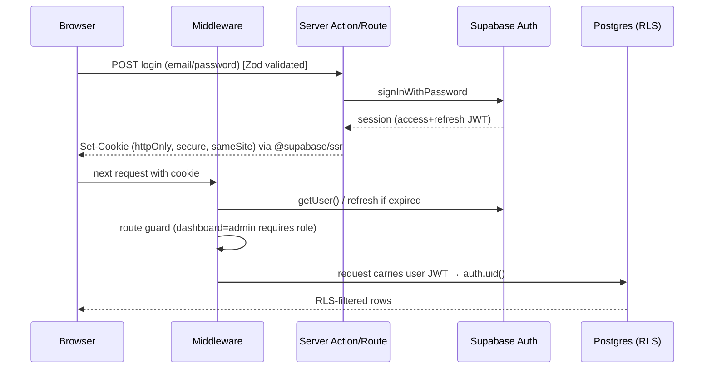
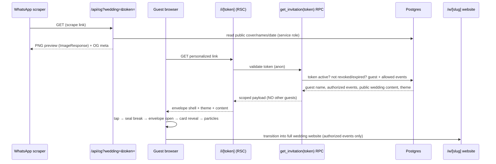
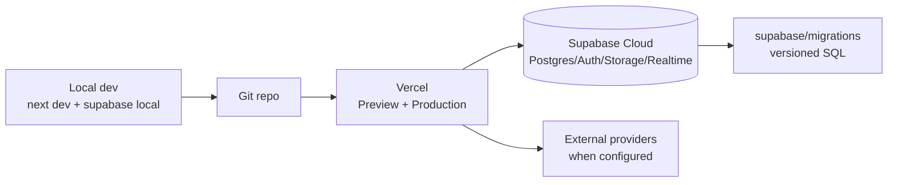

# VOWORA — System Architecture

> Covers the entire platform. Read alongside `implementation-plan.md` and
> `database-schema.md`. Security and the signature invitation experience are first-class.

---

## 1. High-Level Architecture

```mermaid
flowchart TB
  subgraph Clients
    G[Guest browser<br/>mobile-first]
    C[Couple browser<br/>dashboard]
    A[Admin browser]
    W[WhatsApp / social<br/>link scraper]
  end

  subgraph Vercel["Vercel — Next.js 15 App Router"]
    MW[Middleware<br/>session refresh + route guards + rate limit]
    MKT[(marketing) routes]
    AUTH[(auth) routes]
    DASH[dashboard RSC + Server Actions]
    ADM[admin RSC + Server Actions]
    PUB["w/[slug] public renderer"]
    INV["i/[token] invitation experience"]
    API[api Route Handlers<br/>og, webhooks, rsvp, ai, exports, qr]
    OG[next/og ImageResponse]
  end

  subgraph Supabase
    SA[Supabase Auth<br/>JWT sessions]
    PG[(PostgreSQL 15<br/>RLS + SECURITY DEFINER RPCs)]
    ST[Storage<br/>public + private buckets]
    RT[Realtime<br/>command center / RSVP]
  end

  subgraph External["External adapters (PENDING until configured)"]
    EM[Email — Resend]
    PAY[Payments — provider adapter]
    AI[AI — provider adapter]
    MAP[Google Maps]
    AN[PostHog]
  end

  G --> MW
  C --> MW
  A --> MW
  W --> OG
  MW --> MKT & AUTH & DASH & ADM & PUB & INV & API
  DASH & ADM -->|anon key + user JWT, RLS| PG
  PUB & INV -->|anon key, SECURITY DEFINER RPC| PG
  API -->|service role, server-only| PG
  API --> EM & PAY & AI
  PUB & INV --> MAP
  DASH & ADM --> ST
  PG --> RT
  DASH & ADM & MKT --> AN
  SA --> PG
```

**Key boundary rules**
- Browser talks to Supabase **only** with the anon key + the user's JWT → RLS enforces
  row access. The service-role key lives **exclusively** in server code (Route Handlers /
  Server Actions / middleware) and is never bundled to the client.
- Anonymous guests never query tables directly. Public wedding content and guest
  invitation/RSVP flows go through **`SECURITY DEFINER` RPCs** that validate a slug/token
  and return only authorized fields.
- Payment/AI/email secrets are accessed only server-side via adapters.

---

## 2. Frontend Architecture (Next.js App Router)

### Route groups
| Group | Path | Access | Rendering |
|---|---|---|---|
| Marketing | `(marketing)/*` | Public | RSC + selective client islands |
| Auth | `(auth)/*` | Public (redirect if signed in) | RSC + client forms |
| Customer | `dashboard/*` | Authenticated customer | RSC shells + client interactive modules |
| Admin | `admin/*` | Authenticated + platform role `admin`/`super_admin` | RSC + server guard |
| Public wedding | `w/[slug]/*` | Anonymous (published only) | RSC via RPC, ISR/revalidate |
| Invitation | `i/[token]/*` | Anonymous (valid token) | RSC shell + client cinematic experience |
| API | `api/*` | Mixed (webhooks public+verified; rest guarded) | Route Handlers |

### Rendering strategy
- **RSC by default** for data reads (dashboard, admin, public wedding) → less client JS,
  secrets stay server-side, direct secure DB access.
- **Client components** only where interactivity demands: envelope animation, builder
  drag-and-drop, forms, seating canvas, charts, music player.
- **Server Actions** for authenticated mutations (wedding/guest/event CRUD) with Zod
  validation + RLS. **Route Handlers** for webhooks, OG images, exports, AI streaming,
  guest RSVP (token-scoped), QR.
- **Public wedding** uses `revalidate` (ISR) + on-demand revalidation on publish/design
  change so WhatsApp/social scrapers get fresh content.

### State & data
- Server state via RSC + Supabase queries; client cache via React hooks/SWR-style refresh
  on mutation (`revalidatePath`). Realtime subscriptions only for command center + live RSVP.
- Forms: React Hook Form + Zod resolver; schemas shared in `lib/validations`.

---

## 3. Authentication & Session Architecture



- **Cookie-based SSR sessions** via `@supabase/ssr` (browser client, server client,
  middleware client). Tokens refreshed in middleware on every matched request.
- **Methods:** email/password, magic link (passwordless), password reset. OAuth optional
  later (configurable, not assumed).
- **Profile provisioning:** DB trigger `on_auth_user_created` inserts `profiles` row with
  default platform role `customer`.
- **Middleware guards:**
  - `dashboard/*` → require authenticated user.
  - `admin/*` → require authenticated **and** `profiles.platform_role ∈ {admin, super_admin}`
    (checked server-side; never trust client).
  - `(auth)/*` → redirect authenticated users to dashboard.
- **CSRF:** Server Actions use Next.js built-in origin checks; mutations validate input;
  cookies `sameSite=lax`.

---

## 4. Authorization Model (RBAC + RLS)

### Two role dimensions
1. **Platform role** (`profiles.platform_role`): `customer`, `vendor`, `support`, `admin`,
   `super_admin`. Governs admin panel + marketplace vendor management.
2. **Wedding role** (`wedding_members.role`): `owner`, `partner`, `planner`, `family`,
   `viewer`. Governs per-wedding access. A user can belong to many weddings.

### Permission helpers (SQL, `STABLE`, used by RLS)
- `public.is_platform_admin()` → role in (`admin`,`super_admin`).
- `public.is_wedding_member(w uuid)` → exists membership for `auth.uid()`.
- `public.has_wedding_role(w uuid, roles text[])` → membership role ∈ roles.
- `public.wedding_permission(w uuid, perm text)` → fine-grained check (e.g. `manage_guests`,
  `edit_website`, `manage_budget`, `view_command_center`) resolved from role + optional
  per-member permission overrides.

### RLS pattern (per table)
- **SELECT:** member of the wedding (or platform admin).
- **INSERT/UPDATE/DELETE:** member with the relevant permission (owner/partner/planner),
  scoped by `wedding_id`.
- **Config tables** (`templates`, `subscription_plans`, `vendor_categories`,
  `platform_settings`): public read of active rows; write only platform admin.
- **Public/guest:** **no** direct anon table policies. Access via RPC only (see §6).

### Guest authorization (not RBAC — capability tokens)
Guests are anonymous. Authorization is by **unguessable invitation token** →
`invitations` row → `guest` → `guest_events` (allowed events). The RPC returns only that
guest's permitted events and the wedding's public content. See §6–§7.

---

## 5. Signature Invitation Experience Architecture

This is the product's centerpiece (§3). Architecture prioritizes emotion + performance +
security.

### Request flow


### Envelope animation pipeline (client, Framer Motion)
Stages: `sealed → tapping → seal-breaking → opening → card-reveal → settled → website`.
- Pure CSS 3D transforms (`rotateX`, `translateZ`) + opacity for GPU-friendly animation;
  realistic depth via layered shadows and perspective.
- Wax seal: SVG/CSS seal with initials; "break" = scale/rotate/fade split animation.
- Envelope flap: `rotateX` hinge with `transform-origin` top; card slides up + scales in.
- Particles/floral: lightweight CSS/sprite particles, capped count, `will-change` only
  during animation; disabled on reduced-motion + low-end detection.
- **Reduced motion:** `prefers-reduced-motion` → skip to static revealed card; all content
  remains accessible (no information hidden behind animation).
- **Graceful fallback:** if animation libs fail or `ErrorBoundary` trips → render static
  invitation card with full content.
- **Music:** never autoplay. Explicit play/pause control; starts only on user gesture;
  persists preference; respects reduced-motion/data-saver.
- **Performance:** lazy-load theme assets, `next/image` optimized covers, code-split the
  invitation bundle, target smooth 60fps on low-end phones (transform/opacity only).

### Theme system
- 10 themes (`wedding_themes` config + `src/templates/*`): Royal Gold & Burgundy, Emerald
  Green & Gold, Ivory & Champagne, Floral Blush Romance, Modern Minimal, Traditional
  Pakistani, Contemporary International, Royal Mughal, Elegant Arabic, Modern Luxury
  Black & Gold.
- Each theme = envelope design + card design + typography + palette + decorative elements +
  background + opening animation variant + identity. Themes are data-driven (tokens) +
  per-template components; independently customizable.
- Customization overrides (names, initials, wording, colors/gradients, fonts, wax seal
  style, decor, animation, music, intro, photos, event artwork) stored on the wedding/
  invitation design config; **live preview** in the Invitation Designer before publish.

### Dynamic Open Graph / WhatsApp preview
- `/api/og` Route Handler uses `next/og` `ImageResponse` to render an elegant cover PNG
  with **real** couple names, date, title from DB (never hardcoded).
- `i/[token]` and `w/[slug]` emit correct `og:title`, `og:description`, `og:image`
  (pointing to the OG route), `twitter:card`. Personalized where appropriate.
- **Refresh on design change:** on publish/design update, bump a `og_version`/cache-buster
  query param and `revalidatePath` so scrapers fetch a fresh image. Provide an admin/customer
  "refresh preview" action.
- WhatsApp share message built from real couple data + personalized URL; native share
  (`https://wa.me/?text=...`) — no automated Business API claims unless configured.

---

## 6. Secure Public & Guest Data Access (RPC layer)

Anonymous traffic must never read tables directly. All public/guest reads/writes go through
`SECURITY DEFINER` functions owned by a privileged role, with `SET search_path = public`
and explicit validation. They return **only** authorized columns.

| RPC | Input | Returns | Guards |
|---|---|---|---|
| `get_published_wedding(slug)` | slug | public website config, enabled sections, public events, theme | wedding `status='published'`; no guest/private data |
| `get_invitation(token)` | token | guest display name, allowed events, public wedding content, theme, RSVP state | token active, not revoked/expired; rate-limited at API |
| `submit_rsvp(token, payload)` | token + event responses | updated RSVP | token valid; events ⊆ guest_events; attendees ≤ max; Zod validated |
| `submit_guest_wish(token, message)` | token + message | moderation queue item | token valid; visibility couple-controlled |
| `request_gallery_upload_token(token)` | token | signed upload URL | token valid; type/size limits; moderation pending |

**Why RPCs instead of anon RLS:** a single narrowly-scoped function is auditable and cannot
accidentally expose a whole table. `SECURITY DEFINER` bypasses RLS intentionally but the
function body enforces authorization explicitly and selects minimal fields.

### Invitation token design
- Generated server-side with a CSPRNG: `gen_random_bytes(24)` → base64url (≈192-bit
  entropy) or Node `crypto.randomBytes`. **Unguessable.**
- Stored in `invitations.token` with a **unique index**; `status` (`active`,`revoked`,
  `expired`), `expires_at`, optional `max_uses`/`use_count`.
- Lookup is constant-time-ish via unique index; invalid/revoked/expired → generic 404
  (no enumeration hints).
- **Revocation:** set `status='revoked'` → RPC immediately rejects. Resend issues/rotates
  token if needed.
- A guest changing the token/ID in the URL only ever resolves to **their own** row or fails;
  cross-guest access is impossible because the token maps to exactly one guest.
- Rate limiting on token lookup + RSVP prevents brute force/abuse.

---

## 7. Data Flow — Core Journeys

### Publish a wedding website
Couple edits sections (Server Actions, RLS) → `weddings.status='draft'` → preview →
publish action sets `status='published'`, assigns slug, bumps `og_version` →
`revalidatePath('/w/[slug]')` → public RPC serves it.

### Guest RSVP
Guest opens `/i/[token]` → `get_invitation` → sees authorized events → submits RSVP →
`submit_rsvp` validates token + event authorization + attendee limit → writes
`rsvp_responses` → dashboard stats update (Realtime/revalidate) → optional email/notify.

### Subscription purchase (Phase 6)
Checkout created server-side via payment adapter → redirect/hosted checkout → **provider
webhook** → `/api/webhooks/payments` verifies signature → updates `subscriptions`/`payments`
→ entitlements enforced server-side. Browser never sets payment status.

---

## 8. Storage Architecture

| Bucket | Access | Contents | Policy |
|---|---|---|---|
| `public-assets` | Public read | template previews, published covers, OG assets | anon read; admin write |
| `wedding-media` | Private (signed URLs) | couple photos/videos, event covers, gallery | member read/write via RLS; signed URL for public published items |
| `guest-uploads` | Private + moderation | guest QR photo uploads | upload via signed URL from RPC; couple approval before publish |
| `avatars` | Private | profile photos | owner read/write |
| `documents` | Private | invoices, exports, seating charts | owner/admin read |

- **File validation:** MIME + extension allowlist, max size per type, server-side check
  before issuing signed upload URLs; image dimensions validated; strip/scan where feasible.
- **Private by default;** public only for explicitly published assets via signed/CDN URLs.
- `media_assets` table tracks ownership, bucket path, type, size, moderation status.

---

## 9. Internationalization & RTL

- **next-intl** (App Router): locales `en`, `ur`; message catalogs in `src/i18n/messages`.
- Locale via URL segment or cookie; `<html lang dir>` set per locale (`ur` → `dir="rtl"`).
- **Logical CSS properties** (`margin-inline-start`, `text-align: start`) + Tailwind RTL
  variants so layouts mirror correctly.
- Dates/times: store UTC + event `timezone`; render with `date-fns-tz` per viewer/event.
- Currency: per-wedding `currency`; format via `Intl.NumberFormat`; budget amounts stored
  as numeric minor units where precision matters.
- Cultural/religious ceremonies handled by **configurable event types**, not hardcoded.

---

## 10. Integration Adapter Architecture

Each external service is an **interface** with a provider implementation selected by env/
admin config. Unconfigured providers return a typed `NotConfigured` result → UI shows a
clear "not configured" state. **No fake success.**

```
lib/integrations/
  email/      EmailProvider interface → ResendProvider | ConsoleProvider(dev)
  payments/   PaymentProvider interface → StripeProvider | ManualProvider | (PK provider TBD)
  ai/         AIProvider interface → OpenAICompatibleProvider | AnthropicProvider
  maps/       maps helper (embed URL; JS API optional)
  analytics/  Analytics interface → PostHogProvider | NoopProvider
```

- **Email:** invitations, RSVP confirmations, auth (Supabase handles auth email), notices.
- **Payments:** adapter exposes `createCheckout`, `verifyWebhook`, `parseEvent`. Provider
  eligibility (esp. Pakistan) verified before enabling. `ManualProvider` records payments
  without a live gateway so the system works pre-integration. Webhook signature mandatory.
- **AI:** server-side only; provider-agnostic; **authorized wedding data only**; guest PII
  minimized/redacted before prompting; keys never client-side; streaming via Route Handler.
- **Maps:** Google Maps embed for venues/events; JS API optional for discovery.
- **Analytics:** PostHog client + server events; noop until configured.

---

## 11. Realtime Usage

- **Command center** (Phase 7): live schedule/readiness/announcements via Supabase Realtime
  postgres_changes scoped to wedding + member permission.
- **RSVP dashboard** (Phase 5): live counts via Realtime or revalidate-on-mutation.
- Guest-facing pages do **not** open privileged Realtime channels; public updates via
  revalidation only.

---

## 12. Security Architecture (defense in depth)

1. **Transport:** HTTPS everywhere (Vercel), secure/httpOnly/sameSite cookies.
2. **AuthN:** Supabase Auth; SSR session refresh; middleware guards.
3. **AuthZ:** RBAC + RLS on every table; SECURITY DEFINER RPCs for public/guest; server-side
   role checks for admin (never client-trusted).
4. **Input validation:** Zod at every boundary (Server Actions, Route Handlers, RPC payloads).
5. **Tokens:** ≥128-bit CSPRNG invitation tokens; revocation/expiry; generic 404s.
6. **Rate limiting:** middleware/Route Handler limits on auth, token lookup, RSVP, AI,
   webhooks (in-memory dev; Upstash Redis configurable for production).
7. **Secrets:** service-role + provider keys server-only; `.env.example` placeholders;
   no secrets in client bundles or source.
8. **Webhooks:** signature verification before any state change; idempotency keys.
9. **Storage:** private buckets, signed URLs, type/size validation, moderation queue.
10. **Audit:** `admin_activity_logs` + sensitive-mutation logging (who/what/when).
11. **Privacy:** guest PII never in public APIs; account/data deletion workflows; data
    minimization.
12. **Headers:** CSP, `X-Frame-Options`, `Referrer-Policy`, `Permissions-Policy` via
    `next.config` headers.
13. **IDOR prevention:** token-scoped RPCs; security tests attempt cross-guest access.

---

## 13. Deployment Architecture



- **Vercel:** Next.js deploy; env vars per environment; preview deploys per branch.
- **Supabase:** managed project; migrations applied via CLI (`supabase db push`) from
  `supabase/migrations`; RLS + RPCs versioned; storage buckets provisioned by migration.
- **Environments:** local (Supabase Docker), preview, production. Separate keys per env.
- **CI:** typecheck → lint → test → build gate; migrations checked; E2E on preview.
- **Observability:** Vercel logs/analytics + PostHog (when configured) + Supabase logs.

---

## 14. Scalability & Performance

- **Read scaling:** RSC + ISR for public weddings; CDN caching for OG/images; indexed
  queries (see schema); pagination on guest/gallery lists.
- **Write scaling:** Server Actions + RPCs; batched CSV import; background-friendly
  exports via Route Handlers.
- **Animation perf:** transform/opacity-only, code-split invitation, lazy theme assets,
  capped particles, reduced-motion + low-end fallback.
- **DB:** normalized schema, partial indexes (e.g. active invitations), foreign-key indexes,
  `updated_at` triggers; connection pooling via Supabase (pgbouncer) for serverless.
- **Media:** `next/image` optimization, signed CDN URLs, video poster + lazy load.
- **Serverless:** service-role client instantiated per request (no shared mutable state);
  pooling-aware.

---

## 15. Error Handling, Loading & Empty States

- **Error boundaries** per route segment (`error.tsx`) + global; invitation has a static
  fallback so content is never lost.
- **Loading:** `loading.tsx` skeletons per segment; optimistic UI on mutations where safe.
- **Empty states:** every list/module has a designed empty state with a clear CTA (e.g.
  "Add your first guest"), never a blank screen.
- **Not-configured states:** integrations without credentials show an explicit, honest
  "not configured" notice with setup guidance.
- **Validation errors:** inline field errors from Zod; toast for server failures; generic
  messages for auth/token failures (no enumeration).

---

## 16. Architecture Decision Records (summary)

| Decision | Rationale |
|---|---|
| Next.js App Router + RSC | Secrets server-side, less client JS, SEO for public weddings |
| Supabase (Auth/DB/Storage/Realtime) | Integrated RLS + managed Postgres, fits master prompt |
| SECURITY DEFINER RPCs for public/guest | Auditable, minimal-field exposure, prevents IDOR |
| Capability tokens (not guest accounts) | Frictionless guest UX, secure per-guest authorization |
| Adapter pattern for integrations | Configurable providers; honest PENDING states; PK payment flexibility |
| next-intl + logical CSS | English/Urdu RTL without layout rewrites |
| Configurable branding via `platform_settings` | Rename brand without code changes |
| Three design systems | Distinct marketing/dashboard/admin, consistent tokens |
| Framer Motion transform/opacity only | Premium cinematic feel + low-end performance |